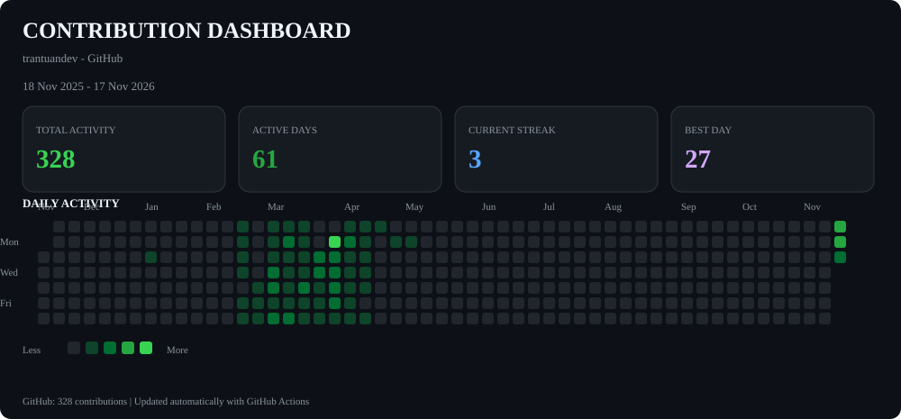

The URL:

`https://raw.githubusercontent.com/vanct-official/vanct-official/main/contributions.svg`

is a direct link to an SVG file stored in a GitHub repository.

If you want to create a **GitHub Contribution Snake** like the one at the URL above, follow the instructions below.

## **1. Create a Repository**

1. Visit [GitHub – New Repository](https://github.com/new?utm_source=chatgpt.com).
2. Name the repository after your GitHub username.

For example, if your username is `vanct-official`, name the repository `vanct-official`.\
3\. Select **Public**.\
4\. Check **Add a README file**.\
5\. Click **Create repository**.

## **2. Create a Workflow to Generate contributions.svg**

To automatically update the snake image based on GitHub activity, use GitHub Actions with the Platane/snk library. It generates an SVG from your account's contribution graph.&#x20;

[image](https://www.google.com/s2/favicons?domain=https://github.com\&sz=32)

GitHub+1


In your repository, create this directory and file:

```
vanct-official/
└── .github/
    └── workflows/
        └── contributions.yml
```

Paste the following into `contributions.yml`:

```

name: Generate Contributions Snake

on:
  schedule:
    - cron: "0 0 * * *"
  workflow_dispatch:

permissions:
  contents: write

jobs:
  generate:
    runs-on: ubuntu-latest

    steps:
      - name: Checkout repository
        uses: actions/checkout@v4

      - name: Generate snake
        uses: Platane/snk/svg-only@v3
        with:
          github_user_name: vanct-official
          outputs: dist/contributions.svg

      - name: Copy SVG
        run: cp dist/contributions.svg contributions.svg

      - name: Commit SVG
        uses: stefanzweifel/git-auto-commit-action@v5
        with:
          commit_message: Update contributions.svg

```

**Note:** Replace `vanct-official` with your GitHub username if it is different.

This workflow creates `contributions.svg` on the `main` branch and updates it daily.

## **3. Allow GitHub Actions to Write Files**

In your repository:

1. Select **Settings**.
2. Select **Actions → General**.
3. Find **Workflow permissions**.
4. Select **Read and write permissions**.
5. Click **Save**.

## **4. Test the Workflow**

1. Select the **Actions** tab.
2. Select the **Generate Contributions Snake** workflow.
3. Click **Run workflow**.
4. Wait for the workflow to succeed (a green check mark).

You will then have this URL:

**Raw SVG**

URL to create

[https://raw.githubusercontent.com/vanct-official/vanct-official/main/contributions.svg](https://raw.githubusercontent.com/vanct-official/vanct-official/main/contributions.svg?utm_source=chatgpt.com)

&#x20;Copy URL

## **5. Display It in Your GitHub Profile README**

Add this snippet to your `README.md`:

```

```

Reference: [Platane/snk – GitHub](https://github.com/Platane/snk?utm_source=chatgpt.com).

Your GitHub Contribution Snake will now update automatically every day!

This guide will show you how to build an **SVG Contribution Dashboard**, place it directly in the `TranTuan-ops/TranTuan-ops` repository, and update it automatically with GitHub Actions.

The dashboard will look like the example you provided:

# **CONTRIBUTION DASHBOARD**

TranTuan-ops · GitHub / GitLab

TOTAL ACTIVITY

# **525**

ACTIVE DAYS

# **137**

CURRENT STREAK

# **0**

BEST DAY

# **16**

This is a layout illustration, not your account's actual data.

**DAILY ACTIVITY**

LessGitHub + GitLab · SVGMore

## **1. Project Structure After Setup**

Add the following files to your repository:

```
TranTuan-ops/
│
├── .github/
│   └── workflows/
│       └── contributions.yml
│
├── scripts/
│   └── generate_dashboard.py
│
├── dashboard.svg
├── contributions.svg
└── README.md
```

- `generate_dashboard.py`: fetches data and renders the dashboard.
- `dashboard.svg`: a GitHub + GitLab statistics dashboard.
- `contributions.svg`: the Contribution Snake image, if you want to keep it.
- `contributions.yml`: updates the snake image daily.

## **2. Prepare Your GitHub and GitLab Accounts**

To retrieve the data, you need to create two access tokens.

### **2.1. Create a GitHub Token**

Visit:

[GitHub Personal Access Tokens](https://github.com/settings/tokens?utm_source=chatgpt.com)

1. Select **Tokens (classic)**.
2. Click **Generate new token (classic)**.
3. Name it `contribution-dashboard`.
4. Choose an appropriate expiration period.
5. Select the `read:user` permission.
6. Click **Generate token**.
7. Copy the token and store it securely.

This token lets the script query your account's contribution data through the GitHub GraphQL API.&#x20;

[image](https://www.google.com/s2/favicons?domain=https://docs.github.com\&sz=32)

GitHub Docs


### **2.2. Create a GitLab Token**

Visit:

[GitLab Personal Access Tokens](https://gitlab.com/-/user_settings/personal_access_tokens?utm_source=chatgpt.com)

1. Name it `contribution-dashboard`.
2. Select the `read_user` permission.
3. Create the token.
4. Copy and store it securely.

GitLab uses the `read_user` permission to query user activity through the Events API.&#x20;

[image](https://www.google.com/s2/favicons?domain=https://docs.gitlab.com\&sz=32)

GitLab Docs+1


Security

&#x20;Do not paste either token into the Python code, README, or YAML files. Store them as GitHub Secrets instead.


## **3. Add GitHub Secrets**

Open the repository:

[TranTuan-ops – Actions secrets](https://github.com/TranTuan-ops/TranTuan-ops/settings/secrets/actions?utm_source=chatgpt.com)

Select **New repository secret** and create these two secrets:

| Name       | Value                |
| ---------- | -------------------- |
| `GH_TOKEN` | The GitHub token you created |
| `GL_TOKEN` | The GitLab token you created |

Click **Save secret** for each token.

## **4. Create the Python File**

In the repository, create a `scripts` directory, then add this file:

```
scripts/generate_dashboard.py
```

This script will:

- Fetch the GitHub contribution calendar for the last 365 days.
- Fetch GitLab events for the same period.
- Combine activity by date.
- Calculate Total Activity, Active Days, Current Streak, and Best Day.
- Export a dark-themed SVG.

Paste the code below into `generate_dashboard.py`:

```
GITLAB_USERNAME = os.environ.get("GITLAB_USERNAME", "YOUR_GITLAB_USERNAME")GH_TOKEN = os.environ["GH_TOKEN"]GL_TOKEN = os.environ["GL_TOKEN"]TODAY = date.today()START_DATE = TODAY - timedelta(days=364)# ==========================================# HTTP HELPER# ==========================================def request_json(url, method="GET", headers=None, data=None):    req = urllib.request.Request(        url,        data=data,        headers=headers or {},        method=method    )    try:        with urllib.request.urlopen(req, timeout=30) as response:            return json.loads(response.read().decode("utf-8")), response.headers    except urllib.error.HTTPError as e:        detail = e.read().decode("utf-8", errors="replace")        raise RuntimeError(            f"API error {e.code}: {detail[:1000]}"        ) from e# ==========================================# GITHUB CONTRIBUTIONS# ==========================================def get_github_data():    print("Fetching GitHub contributions...")    query = """    query($login: String!, $from: DateTime!, $to: DateTime!) {      user(login: $login) {        contributionsCollection(from: $from, to: $to) {          contributionCalendar {            totalContributions            weeks {              contributionDays {                date                contributionCount              }            }          }        }      }    }    """    variables = {        "login": GITHUB_USERNAME,        "from": datetime.combine(            START_DATE, datetime.min.time(), timezone.utc        ).isoformat(),        "to": datetime.now(timezone.utc).isoformat()    }    payload = json.dumps({        "query": query,        "variables": variables    }).encode("utf-8")    result, _ = request_json(        "https://api.github.com/graphql",        method="POST",        headers={
```

**Calculation note:** Total Activity is the sum of the GitHub contributions and GitLab events returned by the APIs. GitLab events are not exactly equivalent to GitHub's contribution calendar; this API may not return some activity types, such as merge requests.

[image](https://www.google.com/s2/favicons?domain=https://docs.gitlab.com\&sz=32)

GitLab Docs+1


## **5. Create a GitHub Actions Workflow to Update the Dashboard**

Create a new file:

```
.github/workflows/dashboard.yml
```

It is recommended that you create a separate `dashboard.yml` instead of overwriting your existing `contributions.yml`. This lets you keep the original Contribution Snake workflow.

Paste in this configuration:

```

name: Update Contribution Dashboard

on:
  schedule:
    - cron: "0 0 * * *"

  workflow_dispatch:

permissions:
  contents: write

jobs:
  generate-dashboard:
    runs-on: ubuntu-latest

    steps:
      - name: Checkout repository
        uses: actions/checkout@v4

      - name: Setup Python
        uses: actions/setup-python@v5
        with:
          python-version: "3.12"

      - name: Generate dashboard
        env:
          GH_TOKEN: ${{ secrets.GH_TOKEN }}
          GL_TOKEN: ${{ secrets.GL_TOKEN }}
          GITLAB_USERNAME: YOUR_GITLAB_USERNAME
        run: python scripts/generate_dashboard.py

      - name: Commit dashboard
        uses: stefanzweifel/git-auto-commit-action@v5
        with:
          commit_message: "Update contribution dashboard"
          file_pattern: dashboard.svg

```

**Important:** Replace `YOUR_GITLAB_USERNAME` with your actual GitLab username.

After you save the file, the workflow will run daily at 00:00 UTC (07:00 Vietnam time). You can also run it manually from the Actions tab.

## **6. Display the Dashboard on Your GitHub Profile**

Open `README.md` in the `TranTuan-ops/TranTuan-ops` repository.

Add the following snippet wherever you want the dashboard to appear:

```

<h2 align="center">📊 My Contribution Dashboard</h2>

<p align="center">
  
</p>

```

Click **Commit changes** to save.

After the workflow succeeds, you can open the dashboard here:

[View dashboard.svg on GitHub](https://github.com/TranTuan-ops/TranTuan-ops/blob/main/dashboard.svg?utm_source=chatgpt.com).

## **7. Test the Dashboard**

After creating all the files, follow these steps:

1. Commit `generate_dashboard.py`.
2. Commit `dashboard.yml`.
3. Open the **Actions** tab.
4. Select **Update Contribution Dashboard** from the left-hand menu.
5. Click **Run workflow**.
6. Wait for the workflow to finish.

[Quickstart for GitHub Actions - GitHub Docs](https://images.openai.com/static-rsc-4/6ACUCBGn-4X25SKeYcdMCLol6oABSdzjA__y5S22ybNY7dP1rDgySFJwl_fGp8qI7xVJ6pwNVLSO1kle-JvES9hMyjvLiH3hrp3KiVeRLPto10N2d-i4BMmFL6PHb3uKpfi3a5D0h7kRLtuNSzrlLG0PF-VjxoxjlW0qaIX7s7s?purpose=inline)

[docs.github.com](https://docs.github.com/en/actions/get-started/quickstart?utm_source=chatgpt.com)

Expected result

The `dashboard.svg` file will appear in the repository. When opened, it will show a dark-themed dashboard with four statistic cards and a 365-day activity chart.

## **8. Information Needed from You**

One important detail is still missing: your actual GitLab username. I don't want to use the wrong username from the example image.

**What is your GitLab username?**

**Which types of activity would you like to include?**

Public activity

Both public and private activity (if the API allows it)

Submit your information

Once I have your username, I can help complete the configuration so the dashboard retrieves data from both accounts correctly.

**API references:**

- [GitHub GraphQL API](https://docs.github.com/en/graphql/reference/users?utm_source=chatgpt.com).
- [GitLab Events API](https://docs.gitlab.com/api/events/?utm_source=chatgpt.com).
- [Git Auto Commit Action](https://github.com/stefanzweifel/git-auto-commit-action?utm_source=chatgpt.com).
